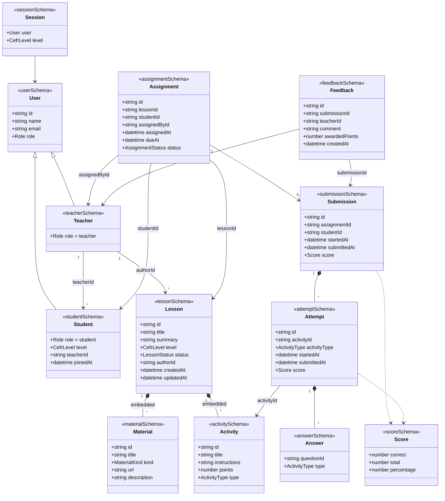
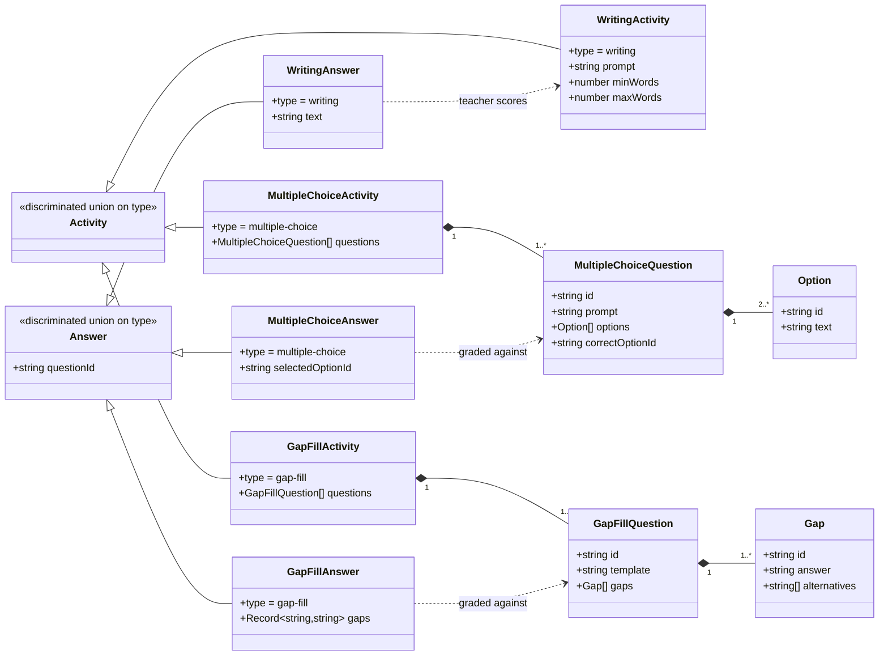
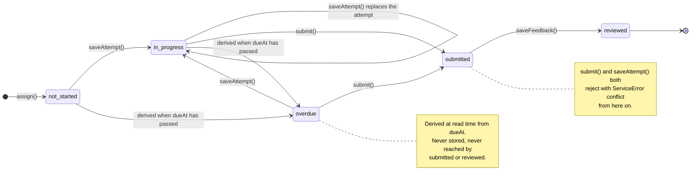

# Domain model

Generated from the Zod schemas in `src/shared/domain`. The schemas are the source of
truth — if a diagram here and a schema there disagree, the schema is right and this
file is stale.

Diagrams are Mermaid, so they render in GitHub and in the VS Code markdown preview,
and they diff as text when the model changes.

Nullable fields are shown without a marker. These are the nullable ones:
`Assignment.dueAt`, `Submission.submittedAt`, `Submission.score`, `Attempt.submittedAt`,
`Attempt.score`, `Feedback.awardedPoints`, `Session.level`. Optional ones are
`Material.description` and `Activity.instructions`.

## 1. Entities and relationships

A filled diamond is composition: the child is embedded in the parent's record, not
referenced by id. A plain arrow is a reference by id, labelled with the field that
holds it.

Two shapes worth noticing, because they are decisions rather than consequences:

`Lesson` embeds its materials and activities instead of referencing them. Page 05
always renders a lesson together with its activities, so a join would buy nothing.
Revisit if a lesson is ever shared across teachers.

`Submission` exists at most once per `Assignment` and is created lazily — it appears
the first time the student saves an attempt, not when the assignment is handed out.
That is why the multiplicity is `0..1` and not `1`.

## 2. The two discriminated unions

`Activity` and `Answer` are unions on a `type` field, not base classes with optional
extras. Adding a fourth activity type makes `ActivityRenderer` (S3.2) fail to compile
until its branch exists — which is the point.

Three constraints live in the schema rather than in the forms, so invalid content
cannot be constructed at all: a `correctOptionId` must name one of its own options,
every `Gap.id` must appear as a `{{placeholder}}` in its question's `template`, and
`maxWords` must be at least `minWords`.

`GapFillAnswer.gaps` is keyed by gap id. A missing key is an unfilled gap, which is
not the same as a wrong one — grading counts it against the total either way, but the
review screen can tell them apart.

## 3. Assignment lifecycle

The five states are exactly what `StatusBadge` (S2.1) renders, so the badge needs no
mapping table of its own.

`overdue` is the odd one: it is never written to a record. `resolveStatus()` in
`mock-assignment-service.ts` derives it from `dueAt` on every read, and refuses to
apply it to work that is already submitted or reviewed. A late submission therefore
reads as `submitted`, not as `overdue`, which is what the teacher's queue needs.

The transition out of `submitted` is one-way for the student: both `submit()` and
`saveAttempt()` raise `ServiceError("conflict")` from there on. That is the duplicate
submission prevention scoped in S4.2, enforced in the service rather than in
`SubmissionBar`.

## Known gap

`Feedback` here models only teacher-written, synchronous review. The S1.2 acceptance
criteria ask for a `source` (AI or teacher) and a processing state, which are not in
the schema and so are not in this diagram. Adding them makes feedback asynchronous,
which changes `FeedbackPanel` (S4.6) and `AnswerReview` (S4.5) — pending a product
decision.
